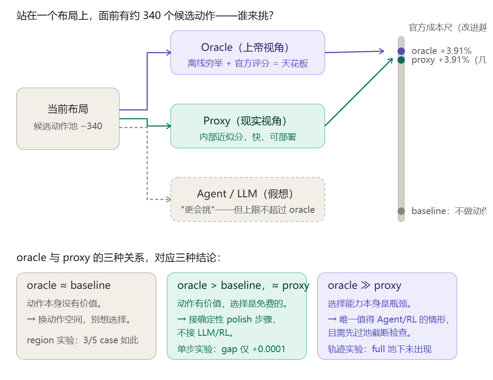

# 从“让 LLM 直接做 Floorplan”到“学习可执行的全局顺序”

上一篇文章已经介绍了 [FloorSet 的问题定义、HPWL、约束、官方评分和 B\*-tree](/posts/ai4floorplan/)。这一篇不再重复基础知识，只记录我们的实验探索过程：我们为什么做一个实验、看到了什么、哪里判断错了，以及下一步为什么改变方向。

这段探索最开始有一个很自然的想法：既然 floorplanning 是一个复杂的序列决策问题，LLM、强化学习或其他神经网络是不是能比传统规则做出更聪明的选择？

但“AI 能不能做”不是一个足够精确的问题。真正需要依次回答的是：

1. **动作有没有价值？** 如果把候选动作全部试一遍，最好的动作能不能改善当前布局？这叫 action headroom。
2. **简单方法会不会选？** 如果好动作存在，便宜的 proxy 是否已经能找到它？
3. **AI 能否补上选择差距？** 只有 oracle 明显优于 proxy，才存在值得学习的 selector gap。
4. **收益能不能部署？** 离线时可以偷看 reference 或 official baseline，比赛推理时不可以。离线上界不等于线上收益。

这里的 oracle 是离线诊断工具：把候选真正执行并用最准确的评分逐个比较；proxy 是比赛时可运行的便宜近似评分。本文默认读者已经从上一篇了解这两个概念，后面只讨论它们在各个实验中的角色。

## 先给出整条时间线

| 日期 | 实验阶段 | 当时想回答的问题 | 最终状态 |
|---|---|---|---|
| 9 月 24 日 | Region Rebuild | 局部区域重排是否值得交给 Agent？ | 负结果 |
| 9 月 24 日 | One-step mutation | 单步树操作是否存在 selector gap？ | 动作有价值，选择几乎免费 |
| 9 月 24 日起 | Trajectory mutation | 多步规划能否重新产生 gap？ | 有阶段性信号，完整 gate 未完成 |
| 9 月 28 日 | Macro Agent v0 | LLM 选高层策略能否提高质量？ | 等算力后没有独立收益 |
| 9 月 29–30 日 | Constructive ordering | 更细的顺序构造动作是否更适合学习？ | 有 headroom，gap 不稳定 |
| 10 月 3 日 | Proxy lookahead | 多看一步能否补上 proxy？ | 平均负收益，关闭分支 |
| 10 月 12 日 | 全局差距诊断 | 为什么局部 selector 很准，整体成绩仍差？ | 问题转向全局结构 |
| 10 月 13 日 | 坐标监督精修 | 能否直接学习 incumbent 到 reference 的坐标残差？ | geometry loss 降低，官方收益为零 |
| 10 月 13–14 日 | SA/EA 调度 | 是否需要动态算法调度或 LLM 调度？ | 固定 EA→SA 足够 |
| 10 月 13–14 日 | Reference-structure oracle | reference 是否含有可执行的全局顺序信号？ | 信号明显，generalization 未证明 |
| 10 月 14 日 | Learned-order proposer | 不看新 case 的 reference，模型能否提出好顺序？ | proposal-recall gate PASS |
| 10 月 15 日 | Selector 首次远端运行 | 能否在部署条件下选中好 proposal？ | 两次保护门触发，正式训练未开始 |
| 10 月 15–16 日 | Proxy/official 错序复核 | 中止来自 bug，还是来自真实目标错配？ | 确认为真实风险，v3 安全门不通过 |
| 10 月 16 日 | Strong-incumbent v4 | 不看 official label，能否限制搜索回退？ | 300-state confirmation 通过 |
| 10 月 16–17 日 | 正式 neural selector | 学习模型能否超过强解析 surrogate？ | 安全通过，AI 增量 gate 失败 |

下面按这个顺序展开。

---

## 第一阶段：先找“值得让 AI 选择”的动作

### 1. Region Rebuild：局部重建本身有没有价值？

Region Rebuild（局部重建）的思路很像重新整理一小块房间：先由传统启发式算法得到一个完整的次优布局，再选出一个局部区域，改变其中 block 的顺序和插入方式，最后重新 pack。



我们枚举了 region 大小、block 顺序、插入位置，以及 connectivity、degree、field order 等构造策略。实验先选了 5 个代表性 case：0、25、50、75、99。每个候选都保留 no-op，也就是“什么都不改”，避免算法被迫接受更差结果。

#### 结果

- 5 个 case 中有 3 个 case 的 oracle 最优动作就是 no-op；
- case 25 和 case 99 确实存在局部重建收益；
- 但在有收益的两个 case 上，proxy 与 oracle 选择完全一致；
- 两个高 block 数 case 的 oracle 也没有达到预设的稳定改善门槛；
- 重放实验逐字节一致，说明结果不是随机复现失败造成的。

这组结果同时否定了两个可能的 AI 入口：多数 case 连动作价值都没有；少数有动作价值的 case，传统 proxy 已经会选。

**结论：Region Rebuild 不是一个值得训练 Agent 的 action interface。** 这不是说所有局部搜索都没用，而是说我们定义的这组 region-level 动作没有形成“好动作存在、传统方法却挑不出来”的稳定缺口。

### 2. One-step B\*-tree mutation：动作有价值，但 proxy 已经会选

Region Rebuild 太粗，我们把动作缩小到一次 B\*-tree mutation，例如 delete-insert、subtree swap、root-child promote。实验固定同一个 seed 和同一组候选，让 proxy 与 oracle 只负责“选哪个动作”，这样不会把 seed 质量或搜索预算混进 selector 比较。

完整实验覆盖 100 个 validation case，每个 case 的动作池大约有 340 个候选。

#### 100-case 结果

| 指标 | 结果 |
|---|---:|
| oracle 找到优于 frozen seed 的 case | 60/100 |
| oracle gain ≥ 1% | 58/100 |
| oracle gain ≥ 5% | 35/100 |
| oracle 与 proxy 选择不同动作 | 1/100 |
| proxy 与 oracle 选择相同 top-1 | 99/100 |
| 高 block 数 bucket 的 oracle 加权收益 | +3.91% |
| random selection 的加权收益 | -17.6% |

这张表要分两层读。

第一，动作确实重要。随机选动作会明显变差，oracle 在 60 个 case 上能改善 seed，所以不能说单步 mutation 没价值。

第二，**动作选择几乎不需要更聪明的模型**。proxy 在 99/100 个 case 上已经选到 oracle 的动作。唯一不同的是 case 89：proxy 与 oracle 的 official cost 只差 0.004989，相对约 0.255%。从所有候选的整体排序看，proxy 与 official 的平均 Spearman 排名相关约为 0.992；这个指标越接近 1，两个排序越一致。即使存在少量局部排序反转，也几乎不影响 top-1。

**结论：单步 mutation 的 action headroom 很大，但 selector gap 几乎为零。** 如果这时训练模型，最容易学到的只是复现 proxy，而不是获得有意义的额外收益。

### 3. Trajectory mutation：单步免费，多步规划呢？

单步最优不等于多步最优。下棋时每一步都贪心，可能走进局部陷阱；有规划能力的决策者可能暂时接受一个普通动作，为三五步后的组合收益铺路。

因此我们从同一个 seed 出发，让 proxy 贪心走 `h` 步，让 oracle 用 beam search 保留多条较好的路径，再比较终点 official cost。这里的 horizon `h` 就是连续动作步数；beam search 可以理解为“每一步不只留一个当前最好方案，而是留几条路继续看”。

#### 实验中踩到的三个坑

**坑一：把 weak 与 production 两档 seed 混着平均。** weak 是故意缩减的搜索预算，production 是正式求解器预算。第一版 gate 把两档混在一起，production 档的零信号稀释了 weak 档的差距，错误地产生了 `NO-GO-TRAJECTORY`。修复后必须按 profile 分档判定。

**坑二：action pool 太小会制造假象。** 轨迹实验最初每步只给 16 个候选，而单步实验有 300 多个。看到 gap 时分不清到底是 proxy 不会选，还是好动作根本没进菜单。后来补做 16、64 和 full-pool 敏感性实验，证明确实存在截断效应。

**坑三：proxy 不能在搜索过程中偷看 official label。** official 分数只能在路径选定后用于离线评估，不能参与 proxy 展开，否则所谓“可部署 proxy”已经被 oracle 信息污染。

#### 修复后看到的信号，以及它为什么还不是最终结论

在一轮仍未完成的 100-case 运行中，早期约三分之二结果显示：

- `h=1` 的 gap 基本为零，与单步实验一致；
- `h=3`、`h=5` 开始出现随步数增长的差距；
- production 档 `h=5` 的阶段性加权 gap 约为 +1.4%，个别 case 接近 +18%；
- 有一个典型 case 中，proxy 贪心走 5 步几乎没有收益，而 oracle beam 找到约 +9.2% 的动作组合。

但把 action pool 扩到 full 后，计算量会按“候选数 × beam 宽度 × horizon”迅速膨胀。最终 100-case full-pool 运行因成本停止，没有形成完整分布和正式通过的 gate。一些小 pool 的 gap 也被证明是 sampling artifact。

因此不能把这一节总结成“多步规划已经被证明有效”，更不能说“CORE 被验证或证伪”。我们的 harness 只是从已有 seed 做连续 mutation；完整 CORE 还包含从空树顺序插入、PPO、EA 种群、RL 与 EA 交换，以及真正的 contour B\*-tree packing。

**准确结论是：多步规划出现过值得关注的阶段性信号，但当前证据不足以把 Agent 放进关键路径。** 单步选择几乎免费，多步可能不免费；至于 LLM 或 RL 能否兑现这部分差距，当时仍是开放问题。

---

## 第二阶段：第一次真的让 LLM 上场

### 4. Macro Agent v0：一个 +8.452% 的漂亮假象

这是第一次真正调用 LLM。我们没有让它直接输出坐标，而是只让它选择高层 profile，例如：

- `baseline_default`：默认参数；
- `connectivity_first`：优先缩短高权重连接；
- `boundary_first`：优先满足边界条件；
- `compact_bbox`：优先让整体更紧凑。

LLM 输出经过严格 schema 校验，再由 deterministic optimizer 执行，最后通过 ExactValidator（精确合法性检查器）检查；失败就回退到 incumbent，也就是当前保存的最好合法布局。

```text
CaseObservation
    → LLM / rule policy
    → MacroIntent
    → schema validator + compiler
    → deterministic optimizer
    → ExactValidator
    → accept or fallback
```

#### 第一轮为什么看起来非常成功

第一轮结果中，LLM arm 相对 baseline 平均提升 **+8.452%**，20/20 个最终布局都保持 exact-feasible。这个数字很诱人，但 15 次真实 LLM 调用中只有 3 次完整通过，另有 12 次触发 fallback；更关键的是，实验并不公平：baseline 只运行原有求解，而 LLM arm 在解释 intent 后又多运行了一轮 optimizer/search。

换句话说，我们同时改变了两个变量：有没有 LLM，以及算了多久。无法知道收益来自决策还是额外算力。

#### Equal-compute：把算力对齐以后再归因

Equal-compute（等算力对照）就是给无 LLM 的对照组完全相同的额外优化预算，只拿掉 LLM 决策。

| 对照 | 相对原 baseline | 相对 compute-only |
|---|---:|---:|
| compute-only：多算一轮，无 LLM | +8.452% | — |
| LLM one-shot | +8.452% | 0% |
| LLM one-feedback | +8.612% | +0.183% |

原来的 +8.452% 被 compute-only 完整复现，说明它来自多算一轮，而不是 LLM。feedback 的 +0.183% 只出现在少数 case，证据不足以支撑上线。

之后我们进一步简化输出，让 LLM 只选 profile，不再处理 focus block 等复杂字段。15/15 次调用都通过 schema，fallback 为 0，但模型 15/15 次都选择 `connectivity_first`。三次独立 repeat 中，它相对 compute-only 分别为：

```text
-2.055%、-2.253%、-2.958%
```

**结论：安全 harness 跑通了，不代表 LLM 带来质量收益。** 粗粒度 profile 不是合适的 Agent action interface；初始正结果主要是算力混淆。

---

## 第三阶段：把动作做细，再给 deterministic 方法一次机会

### 5. Constructive B\*-tree-shaped ordering：有动作空间，但还不是真正的 B\*-tree packing

Profile 太粗，于是我们把每一步细化为：

```text
next_block   下一步放哪个 block
target_block 挂到哪个已有 block 上
left/right   使用哪个结构槽位
rotate       是否旋转
```

这个动作空间更像 sequential construction。但当时的执行器有一个关键限制：

```text
B*-tree-shaped state
        → preorder
        → 现有 deterministic packer
        → geometry
```

也就是说，树结构最终被压成 preorder 顺序，再交给旧 packer。不同树如果 preorder 相同，可能得到完全相同的几何布局。所以这里测试的是 **B\*-tree-shaped ordering**，不是经典 contour B\*-tree packing，也不能说已经复现 CORE。

#### 从 cap1 到 cap16

`action cap` 是每一步允许比较的候选数量。cap1 只能验证管线能跑，不能测试 selector；cap4 出现过小规模信号；cap16 才覆盖更多 next block、target、左右槽位与旋转组合。

formal cap16 中，case 99 因 exact packing 时间过长而停止，最终只有 4 个完整 case：

| case | official 相对 fixed | official 相对 proxy |
|---:|---:|---:|
| 0 | +35.73% | -4.94% |
| 25 | +28.02% | -4.64% |
| 50 | +24.69% | +4.81% |
| 75 | +32.03% | +0.85% |

四个 case 都有明显 action headroom：换一个构造顺序确实可能大幅改善 fixed heuristic。但 oracle 相对 proxy 的选择差距只有 case 50 超过 1%，四个 case 平均反而约为 -0.98%。

**结论：更细的 constructive ordering 是有价值的动作空间，但当前投影实现尚未形成跨 case 稳定的 selector gap。** 4/5 partial 也不能冒充完整五案例 gate。

### 6. Proxy lookahead：多看一步，为什么反而更差？

既然一步 proxy 可能短视，一个自然想法是 one-step lookahead：对每个第一步动作，再模拟若干第二步 continuation，用第二步 proxy cost 评价第一步。

实验使用 case 0、50、75，第一步 cap16，第二步 continuation cap4，并比较 fixed、proxy greedy、proxy lookahead 与 official greedy。

| case | lookahead 相对 proxy greedy |
|---:|---:|
| 0 | -40.398% |
| 50 | +7.712% |
| 75 | +13.047% |
| **平均** | **-6.547%** |

lookahead 额外使用了 11,456 次 continuation evaluation，official greedy 仍平均比它好约 2.696%。三个最终布局虽然都 exact-feasible，但收益方向极不稳定。

case 0 的失败是典型的 horizon/proxy mismatch：某个第一步可以让“下一步 proxy”看起来很好，却把后续完整布局锁进更差的结构。多看一步并不自动等于看得更远；如果中间评价函数与最终目标错位，lookahead 只会更坚定地走错方向。

**结论：当前 deterministic lookahead 收尾实验为负，分支关闭。** 到这里，我们已经系统测试了局部 region、单步、多步、LLM profile、细粒度 constructive action 与短视 lookahead，却仍没有找到稳定的局部 selector gap。

---

## 第四阶段：也许问题根本不在“下一步选什么”

### 7. 重新看全局差距：proxy 很准，为什么完整布局仍然差？

10 月 12 日，我们回头复核了 one-step 的全部 100-case 数据。结果再次确认：proxy 与 oracle 只有 case 89 的 top-1 不同，差距约 0.255%。继续在这个选择问题上堆模型，理论收益上限太小。

但这时出现了一个更重要的问题：**如果局部 selector 已经这么准，为什么当前 seed 的整体分数仍与 reference 有明显差距？**

这正是当时最容易混淆的两个数字：基础方法的整体成绩约为 1.72，而 reference 对应的水平约为 1.1；两者差得很大，似乎与“proxy 和 oracle 在 99/100 个 case 上选中同一动作”矛盾。其实它们衡量的不是同一件事。99/100 只说明：**从同一个既定 seed 出发，在同一个单步候选集合中，proxy 几乎总能挑到 oracle 也会挑的动作。** 它完全没有说明这个 seed 是否处在正确的全局布局区域，也没有说明候选池里包含了通往 reference-like layout 的大尺度重构。

可以把它类比为：两位导航员在每个路口几乎都同意“当前哪条支路更快”，但汽车一开始就在错误的城市。局部选路再准确，也无法解释起点与目的地之间的全局差距。

我们比较了 case 0、25、50、75、99 的 seed 与 reference 指标：

| case | blocks | seed cost | HPWL / reference | bbox / reference | seed density |
|---:|---:|---:|---:|---:|---:|
| 0 | 21 | 1.385 | 1.339× | 1.431× | 0.699 |
| 25 | 46 | 2.356 | 1.524× | 1.226× | 0.869 |
| 50 | 71 | 3.327 | 1.632× | 1.425× | 0.732 |
| 75 | 96 | 2.441 | 1.840× | 1.221× | 0.860 |
| 99 | 120 | 2.822 | 1.708× | 1.189× | 0.853 |

差距不是一个局部动作造成的，而是多种全局假设同时偏离：

- seed 中 76%–90% 的 soft block 近似正方形，reference 中只有 7%–14%；
- seed 的整体 frame 更细长、更松，case 0 约为 `116×300`，reference 约为 `152×160`；
- 高连接 block 的全局拓扑位置不够集中；
- boundary、grouping 等软约束会把小的结构错误指数放大。

这一步改变了研究问题：

> 局部动作的选择几乎饱和，但 seed-level global construction 仍有明显差距。

比起学习“下一步 mutation 选哪个”，更值得研究的是 block shape、全局 frame、connectivity-aware order 和结构约束。

### 8. 直接坐标监督精修：geometry loss 成功，官方目标失败

有了 100 万 reference，一个很自然的监督学习方案是：给模型当前 heuristic 布局和电路特征，让它预测从 incumbent 到 reference 的 `(x,y,w,h)` 残差。

#### 数据与基线

- 前 1,000 个训练 reference 全部通过 overlap 与 area 检查；
- 同一台 4090/16 核服务器上，正式 solver 连跑 5 次，100-case total score 平均 1.789016，标准差 0.004677，五次均 100% feasible；
- 用 1 秒低预算 heuristic 生成 1,000 个 incumbent，按 identity 切成 796 train、102 validation、102 evaluation；
- 模型输入面积、约束、连接度数和当前几何，预测位置与 aspect-ratio 残差。

Geometry-only 模型把验证 geometry loss 从 identity 的 0.024568 降到 0.011416，下降约 54%。如果只看训练曲线，这像是一个成功结果。

#### 第一个坑：float32 制造了 3,276 个假重叠

初版评估把 double 精度的合法 incumbent 存成 float32，再恢复到原尺度。大量紧密接触的 block 因微小舍入产生穿透：中位深度约 `2.86e-6`。旧 repair 又把这些 block 整体推开，使 identity 布局的平均 cost 从约 4.93 被破坏到 9.97。

因此第一版“模型无收益”结论本身无效。修复后，系统保存原始 double incumbent；模型只提供相对残差，并沿 `alpha=1` 到 `2^-16` 做 exact-feasibility line search。`alpha=0` 必须逐位复现原始合法布局。

#### 修复后的 102-case exact 结果

| 指标 | Geometry-only | Geometry + overlap |
|---|---:|---:|
| 完整预测 `alpha=1` 合法 | 0/102 | 3/102 |
| 存在任意合法非零步 | 0/102 | 86/102 |
| 合法非零步降低 official cost | 0/102 | 0/102 |
| 安全门最终接受 | 0/102 | 0/102 |

加入 overlap loss 后，86 个 case 能走一个极小的合法步，但其中 76 个最佳步长只有 `2^-16`。这些候选平均仍比 incumbent 差 3.3197。HPWL gap 与 area gap 的平均变化都只有约 `1e-4`，真正恶化的是 soft-constraint violation ratio，平均增加约 0.288。

这揭示了直接坐标回归的根本错配：reference 与 incumbent 往往不是同一个局部拓扑。把全局换序、换行列和邻接重构平均成每个 block 的独立位移，会破坏原布局中精确的接触关系。坐标更接近 reference，不等于 official cost 更低。

**结论：暂停扩大直接坐标残差模型。** 这个负结果没有否定监督学习，而是说明输出空间必须尊重可执行结构。更合理的目标是学习合法动作或全局顺序，再由 deterministic packer 和 exact validator 负责几何。

### 9. 自适应 SA/EA/LLM 调度：最后留下的是固定 EA→SA

另一条独立研究线问的是：传统求解器内部有 SA、EA 等不同算法，是否需要一个智能 scheduler 根据当前状态不断选择“下一轮用哪个算法”？这里的 EA 是 evolutionary algorithm（演化算法），维护并变异一组候选；SA 则是上一篇介绍过的模拟退火。

#### Stage 1：互补性确实存在

在 100 cases、800 states、7,200 次运行中，per-state oracle 的平均 gain 为 +0.04550，最佳固定算法为 +0.03193，选择 headroom 为 +0.01357，95% 置信区间不跨零。

但 headroom 几乎全部集中在“当前还是 raw seed”这一档：

| incumbent 阶段 | 最佳算法 | gain |
|---|---|---:|
| 0s raw seed | EA | +0.1215 |
| 1s refined | SA | +0.0212 |
| 10s refined | SA | +0.0070 |

这更像一个阶段顺序，而不是复杂的算法组合问题。

#### Stage 2：八个自适应策略都输了

K=3，也就是每个 episode 连续调度三轮。在 10,800 个 episodes 中，8 个预注册 adaptive policies 全部输给 `fixed_ea`。最佳 adaptive 只有 +0.01869，而 `fixed_ea` 为 +0.04164。原因包括：三轮、三个 arm 让 bandit 根本没有利用阶段；错误观测量把“由 bottom-left packer 产生”误当成“EA 仍有效”；读取和构造 observation 本身还占约 16.4% 的 episode 时间。

后来用 surrogate cost 做了一个 post-hoc 的 K=1 规则：cost 高时选 EA，否则选 SA。它确实在 held-out half 上比 always-EA 高 +0.00514，说明 raw seed 与 refined state 的 regime 可以识别。

但真正关键的对照是：**它是否比完全不看状态的固定 `EA→SA→SA` 更好？**

在 K=3 held-out 50 cases 上：

| 策略 | mean gain |
|---|---:|
| fixed `EA→SA→SA` | +0.04936 |
| cost gate | +0.04804 |
| fixed EA | +0.04766 |
| fixed SA | +0.02177 |

gate 相对固定顺序为 `-0.00132`，置信区间跨零；同时 gate 花了 0.3576 秒读取状态，占 1.658 秒 episode 的 21.6%，固定顺序不付这笔税。

#### LLM probe：昂贵地打平，而且答案来自 prompt 提示

由于 Stage 2 没有通过，LLM 只做了 20-case bounded probe，不是正式 Stage 3。实际延迟下 100% episodes 都因预算中止；即使把 LLM 延迟从预算中“退款”，它也只是与最佳固定策略和一行规则打平。

更说明问题的是 prompt ablation：提示中明确告诉模型 regime anchor 时，它在 raw seed 更多选择 EA、在 10s state 不选 EA；去掉提示后，选择方向几乎反了。模型表现依赖我们把答案线索写进 prompt，而不是自己从状态中发现规律。

**结论：不需要在线 adaptive scheduler，也不需要 LLM scheduler。** 最实用的策略就是先从 raw seed 跑一次 EA，再把剩余预算交给 SA。

---

## 第五阶段：从 reference 中学习“可执行的全局顺序”

### 10. Strong-incumbent reference oracle：真正缺的变量可能是全局 order

直接坐标回归失败后，我们不再要求模型画出坐标，而是问：reference 中是否存在一种可以交给现有 packer 执行的结构信号？

实验选 16 个 validation identities，每个分别生成 1 秒、3 秒、10 秒的 strong incumbent，共 48 个状态。每个状态比较相同候选预算下的五类 proposal：

- legacy：旧的一步 B\*-tree 投影动作；
- constraint：boundary、cluster、MIB、强连接邻接等手工复合规则；
- random：随机全局排列；
- correct reference：从同一个 case 的 reference 几何提取 y-x、x-y 等顺序；
- shuffled reference：保留 reference 的空间分布，但随机打乱 block 身份。

shuffled control 很重要：如果它也有效，收益可能只是来自“多了几个看起来像 reference 的空间样本”；只有 correct reference 明显更强，才能说明 block 身份与电路结构的对应关系包含信息。

#### cap64 结果

| proposal pool | 改善状态 | mean gain |
|---|---:|---:|
| legacy | — | 0.175% |
| random | — | 1.085% |
| handcrafted constraint | 9/48 | 0.871% |
| shuffled reference | — | 0.324% |
| **correct reference** | **16/48** | **6.148%** |

correct reference 在所有 16 个有效改善状态上都同时击败 rule-only 与 shuffled control，收益集中在 case 5、40、50、75、85、95。最大改善包括 case 85 的 35.29%、case 40 的 32.72%、case 50 的 27.67%。绝大多数最佳 proposal 来自全局 `y-x` order。

**这通过了 reference-signal gate，但还没有通过 generalization gate。** correct-reference 是 same-instance oracle：它在新测试 case 上不可用。实验只证明“全局顺序中确实藏着可执行的大收益信号”，没有证明模型能从其他 case 学会并迁移这个信号。

### 11. Learned-order proposer：第一次出现清楚的学习正信号

下一步不再预测坐标，而是训练一个轻量 graph ranker，为每个 movable block 输出 `yx_score` 和 `xy_score`。把 block 按分数排序后，交给现有 deterministic packer 生成合法几何候选。

这里先解释两个术语：

- **Proposer**：负责提出若干候选顺序，不负责决定最终采用哪个。
- **Proposal recall**：这些候选里是否至少包含一个好解。它只衡量“好答案有没有被提出”，不衡量部署时能否把它挑出来。

#### 数据与泄漏控制

- 10,000 个训练 case，30,000 个 order examples；
- 2,000 个 model-validation case，6,000 个 examples；
- 三个训练 seed；
- checkpoint 只按 validation Kendall tau 选择，不看 48-state exact cost；
- 正式数据门加入 label-intervention：替换 `fp_sol` 时，current order、node features 和 adjacency 必须完全不变，只有监督目标允许变化。

这一条是开发中真实踩过的坑：早期版本曾把“reference order 加少量交换”作为 current order，相当于把接近答案的 rank 偷渡给模型。该版本在正式生成前被废弃。

三个 seed 的 validation mean Kendall tau 都约为 0.892–0.893。Kendall tau 用来衡量两个顺序的一致程度，越接近 1 越一致；输入 current-order baseline 只有约 0.07。因此模型确实学到了 reference-like 排序，不是复制输入顺序。

#### Offline exact best-of-K 结果

评估仍使用之前的 48 个 diagnostic states。每个模型提出 K 个候选，再用带 reference baseline 的 exact official cost 事后选择最好的一个，并始终允许 no-op 回退。

| K | learned mean gain | random | constraint | legacy | improved states |
|---:|---:|---:|---:|---:|---:|
| 4 | 6.0677% | 0.1002% | 0.0000% | 0.1285% | 15/48 |
| 8 | 7.2665% | 0.1020% | 0.0720% | 0.1499% | 17/48 |
| 16 | **8.0594%** | 0.3615% | 0.1933% | 0.1499% | **18/48** |

三个训练 seed 在 K=16 的离线上界分别为 8.0594%、8.0158%、8.1827%，说明正信号不是某个随机初始化偶然产生的。K 从 4 增加到 16 时，`blend_yx_0.75` 和小幅 `perturb_yx` 提高了好解召回。

但 **8.06% 不是可部署收益**。它是 offline exact best-of-16：我们事后偷看 official baseline，才知道 16 个候选中哪个最好。原始候选分布清楚地说明 selector 不是形式问题：

- 2,304 个 learned candidates 中，1,633 个（70.9%）hard-feasible；
- 可行候选中只有 327 个优于 incumbent，1,306 个更差；
- 如果不做选择而直接平均采用，可行候选的 mean gain 是 **-37.14%**。

另外，18/48 states 只对应 7–8 个 unique case identities，因为同一个 case 有三个预算版本；这不是 18 个独立新电路。使用的 16 个 identities 也已经参与过多轮方法设计，只能作为 diagnostic set，不能称为 untouched final test。

**阶段结论：proposal-recall gate PASS。** 这是整条路线中第一次出现明确、可复现的学习正信号：模型能提出传统 random、constraint 和 legacy pool 很难覆盖的好顺序。接下来真正的瓶颈变成了 label-free selector。

### 12. Label-free selector：从两次中止到一次完整的正式实验

Learned-order proposer 证明了候选池里能出现好布局，但比赛不会告诉我们哪个候选好。Selector 的任务就是：在看不到 reference 和 hidden baseline 的条件下，只使用 incumbent 与 candidate 自身可计算的特征，判断是否值得替换。如果没有足够把握，就 abstain（拒绝出手），保留原布局。

这一步很容易被写成普通二分类：给候选打“改善/不改善”标签，训练一个 MLP 即可。但真正困难的是，部署时的选择器必须同时满足三件事：

1. 不能读取 reference、official cost 或 case identity；
2. 必须先过滤 hard-infeasible 候选；
3. 不仅要比 no-op 强，还要超过现有的解析 surrogate，否则神经网络没有独立价值。

我们预先冻结了四块互不重叠的数据：2,000 个 selector-train identities、500 个 selector-validation identities、24 个公开 confirmation identities，以及 60 个只能在全部方法冻结后查看一次的 final-integration identities。三个 proposer checkpoint、split hash、feature schema 和正式协议也一起冻结。

#### 第一次保护门：repair 生成了负坐标

第一次远程生成中，case 50876 的 cluster repair 把两个 movable block 放到了 `y=-9.165...`。Official evaluator 的 bbox 会随整体布局移动，所以负坐标本身不一定非法；但内部 BottomLeftPacker 假设 obstacles 位于非负坐标框架。换句话说，两个模块各自都按自己的规则工作，却没有共享同一份坐标契约。

修复策略不是粗暴地把整个布局平移，而是跳过明显落到负坐标的候选，只把数值误差级别的负零吸附到 0。定向测试、真实 case 重放和 exact validation 通过后，我们清空不完整产物，重新开始生成。

#### 第二次保护门：proxy 改善，official cost 回退 0.0553%

第二次运行在 case 75035 停止：

```text
seed official cost       = 3.301283740350
search incumbent cost    = 3.303110023152
relative regression      = 0.055320%
```

这个布局 hard-feasible，搜索 proxy 也认为它更好；但 official cost 比 seed 略差。当时协议要求 official cost 不能回退超过 `1e-12`，所以 8 个生成 job 全部自动退出。中止时只计算了 401/7,500 groups，尚未写出正式 shard，三个 selector checkpoint 和 24-case confirmation 都不存在；60-case final split 也没有被访问。

这次中止的正确状态是 `INCOMPLETE`，不能拿来证明 selector 成功或失败。它只提出了一个必须先回答的问题：case 75035 是保存/恢复 bug、评估器不一致，还是 proxy 与 official objective 的真实排序反转？

#### 复核 case 75035：不是一次偶然的 evaluator 抖动

我们随后对同一 case 做了五次独立的 1 秒搜索，并重新计算 official cost、检查 exact feasibility、几何快照和 provenance。五次搜索中 proxy 每次都改善，但有一次 official cost 回退了 0.05533%，另外四次 official cost 改善。保存前后的 official 重算一致，布局合法，来源链也一致。

因此，最合理的解释不是“评估器算错了”，而是两个目标真的不完全一致。Proxy 不读取 reference baseline，主要依据当前可见的 HPWL、bbox 与软约束；official cost 则使用 reference 指标做归一化，并对不同误差项进行组合。在 case 75035 的回退样本中，搜索减少了 soft violations，却付出了更大的 HPWL 增长，proxy 与 official 对这笔交换给出了不同排序。

这也解释了为什么 one-step 实验可以 99/100 top-1 一致，完整搜索仍然需要安全门：99/100 描述的是一组固定候选上的单次 top-1；长时间随机搜索会访问更多状态，只要排序反转概率不是严格为零，最终就会遇到。

### 13. Strong-incumbent v3/v4：先把输入布局的风险控制住

Selector 数据的每个 group 都从一个 strong incumbent 出发。如果 incumbent 本身因为 proxy 错序而明显劣于 seed，模型训练再正确也只是在错误起点上学习。因此正式训练前先单独验证 incumbent 生成协议。

#### v3 dry run：300 个状态中仍有 4 个 official 回退

我们在 100 个 case、1/3/10 秒三个预算上生成了 300 个 incumbent。所有状态都通过 exact feasibility、provenance、坐标与恢复审计，但 official quality gate 没通过：

| v3 dry-run 指标 | 结果 |
|---|---:|
| 总状态数 | 300 |
| hard-infeasible / provenance error | 0 / 0 |
| official regression states | 4 |
| regression P95 | 1.837% |
| worst regression | 2.0785% |

这说明工程正确性已经足够，但目标错配仍可能制造不可接受的质量回退。更重要的是，部署时不能用 official label 判断是否回退；如果搜索后再偷看 official cost 并恢复 seed，等于把隐藏答案放进了算法。

#### v4：用可部署的 HPWL guard 做保守回退

诊断显示主要风险来自 HPWL 明显上升，因此 v4 加入一个完全 label-free 的规则：

```text
如果 search_hpwl / seed_hpwl > 1.06：回退到 seed
否则：保留 search incumbent
```

阈值先在开发集合冻结。开发数据中它捕获了 3/3 个 official regressions，接受 279/300 个搜索结果，并保留约 91.9% 的正向 official gain。随后在另一组 100-case×3-budget confirmation 上重新验证：300/300 状态合法，最终选择的 official regression 为 0；guard 触发 12 次，保留了原始正收益的 92.655%，阶段 gate 通过。

这里还有一个很有意思的细节：confirmation 中被 guard 拒绝的 12 个 raw candidates，事后用 official label 看其实都改善了。也就是说，这个安全门是保守的，会牺牲一小部分潜在收益。但在部署时看不到 label，与其假装能完美判断，不如明确支付一笔可测量的 safety tax。v4 的价值不是“知道真正答案”，而是在只看可用信息时把严重回退风险压到可接受范围。

### 14. 正式 selector：神经模型有效，但没有超过强 surrogate

v4 incumbent 协议通过后，正式实验才真正开始。

#### 数据、模型和对照

每个 identity 生成 1、3、10 秒三个 incumbent；每个 group 包含 K=16 个 proposal 和一个 no-op。因此正式数据规模为：

| 项目 | 数量 |
|---|---:|
| selector train identities | 2,000 |
| selector validation identities | 500 |
| budgets | 1s / 3s / 10s |
| groups | 7,500 |
| examples | 127,500 |
| data shards | 256 |

数据审计确认 7,500 个 work keys 全部存在，没有重复或额外 group；protocol、proposer、schema hash 唯一一致；data gate 全部通过；60-case final split 未访问。

Selector 是一个使用 32 维部署可见特征的小型两层 MLP，共享 encoder 后连接三个训练目标：候选是否改善的 balanced BCE、official cost delta 的 SmoothL1，以及 group 内候选相对排序的 pairwise loss。它不读取 reference、hidden baseline、official cost、case id 或文件顺序。三个随机种子均训练 40 epochs，validation 校准后的 abstention threshold 分别为 0.02、0.02 和 0.001。

真正有意义的主对照不是 no-op，也不是只看 HPWL 的简单规则，而是 `Reference.for_selection` surrogate。这个名字容易误解：它不读取数据集 reference，而是用候选集合的最小 HPWL、已知的总体密度先验和 exact soft violations 构造一个固定解析评分。它在早期 diagnostic 数据上已经非常接近 exact oracle，因此是神经 selector 必须击败的强 incumbent。

#### 24-case confirmation：72 个部署状态

冻结模型和 threshold 后，我们在 24 个 confirmation cases、三个时间预算上评估，共 72 个 state。下表中的 gain 是 **official cost 的绝对下降量**，不是百分比；regret 是 exact oracle 能得到的 gain 减去该选择器实际得到的 gain，越低越好。

| 选择器 | mean gain | mean regret | 改善 | 变差 | abstain | 所选布局全部合法 |
|---|---:|---:|---:|---:|---:|---:|
| Neural seed 20261014 | 0.208445 | 0.003777 | 24 | 1 | 47 | 是 |
| Neural seed 20261015 | 0.208911 | 0.003311 | 25 | 0 | 47 | 是 |
| Neural seed 20261016 | 0.201420 | 0.010802 | 19 | 0 | 53 | 是 |
| **解析 surrogate** | **0.211960** | **0.000262** | **29** | **1** | **42** | 是 |
| exact oracle 上界 | 0.212222 | 0 | 29 个 state 可改善 | — | — | 是 |

这张表有两个需要同时保留的结论。

第一，模型不是完全没学会。三个 seed 都能安全选择并在 19–25 个 state 上改善 incumbent；所有被采用的布局都 hard-feasible，说明 exact mask 与 abstention 机制有效。若只和 no-op 比，它当然是有用的。

第二，它没有提供超过解析 surrogate 的增量价值。以预注册的 median seed 口径计算：

- neural mean gain 比 surrogate 低 0.003514；
- neural mean regret 为 0.003777，surrogate 只有 0.000262，前者约为后者的 14.4 倍；
- 三个 neural seed 与 surrogate 逐 state 比较，分别是 `2 better / 62 equal / 8 worse`、`1 / 63 / 8`、`1 / 58 / 13`；
- surrogate 得到了 exact oracle mean gain 的约 99.88%。

预注册的 AI incremental gate 要求：median neural regret 至少比 surrogate 低 10%，或者 mean gain 至少高 0.005 cost units，同时 worsened states 不能增加。两个条件都没有达到。因此最终 gate 是：

```text
Safety gate:             PASS
Neural incremental gate: FAIL
```

这不是“神经网络不能做 floorplanning”。它给出了更窄、更有用的判断：**在当前 proposal pool 与特征下，选择问题已经被一个强解析 surrogate 基本解决，继续扩大 selector 网络的研究回报很低。**

#### 一次额外的工程教训：4090 并不自动让小模型训练快

三个 MLP seed 的训练总共用了约 7 小时 49 分，远高于最初估计。监控显示 GPU 利用率大多只有约 6%–8%，同时单个 CPU 核长期满载。瓶颈不是模型太大，而是训练循环按 group 顺序执行大量很小的 GPU 操作，kernel launch、Python 控制流和数据准备吞掉了时间。

它不会改变科学结论，但会改变后续工程：如果还训练类似 groupwise selector，应先批量化 group loss 和数据加载，再考虑换更大的 GPU。统一机器有助于可比性，却不能代替性能剖析。

---

## 把所有实验放在一起看

| 实验 | 关键证据 | 简单方法能否替代 | 最终决定 |
|---|---|---|---|
| Region Rebuild | 多数 case 的最优动作是 no-op | 有收益处 proxy=oracle | 关闭 |
| One-step mutation | 60/100 有动作收益 | proxy 99/100 选中 oracle top-1 | 不训练局部 selector |
| Trajectory | 多步出现阶段性 gap | full-pool 正式 gate 未完成 | 保留信号，不上线 |
| Macro Agent v0 | 表面提升 +8.452% | equal-compute 完整复现 | 关闭 profile Agent |
| Constructive ordering | 动作 headroom 明显 | gap 跨 case 不稳定 | 不接 LLM |
| Proxy lookahead | 平均收益 -6.547% | 额外计算也没救 | 关闭 |
| Coordinate refinement | geometry loss 下降约 54% | exact improvement 0/102 | 停止扩大坐标回归 |
| Adaptive scheduler | 算法优势依赖 incumbent 阶段 | 固定 `EA→SA→SA` 胜过 adaptive gate | 不做在线调度 |
| Reference order oracle | mean gain 6.148% | 手工/random 无法恢复 | 学 global order |
| Learned-order proposer | offline best-of-16 上界约 8.06% | 明显胜过传统 proposal | proposal 路线继续 |
| Strong-incumbent v4 | 300-state confirmation 零最终回退 | 1.06 HPWL guard 可控制风险 | 采用保守 guard |
| Neural selector | 安全，但 median gain 0.208445 | surrogate 为 0.211960，接近 oracle | 停止扩大 neural selector |

## 截至 2026 年 10 月 17 日，我们真正学到了什么

### 1. “动作有价值”与“需要 AI”是两回事

One-step mutation 是最典型的例子：oracle 能把 seed 改好，不代表需要学习模型；proxy 如果已经在 99/100 个 case 上选到同一动作，AI 的可用上限就非常小。正式 selector 再次给出同样的教训：神经模型本身有收益，不等于它比强解析方法更有收益。

### 2. 任何正结果都要先做归因

Macro Agent 的 +8.452% 最终来自额外计算。自适应 gate 看似聪明，最后被固定 `EA→SA→SA` 顺序击败。Learned-order 的 8.06% 是 exact best-of-16 上界，不是线上收益。实验中只要同时改变算力、候选菜单和决策者，漂亮数字就很难解释。

### 3. 输出表示往往比模型大小更重要

坐标回归把 geometry loss 降了一半，却无法产生一个 official cost 更低的合法布局；learned order 使用更小、更结构化的输出，反而出现明确正信号。模型不需要亲自画出 `(x,y,w,h)`，它更适合预测 packer 能执行的全局顺序或少量结构决策。

### 4. Proposal generation 与 proposal selection 是两个研究问题

Learned proposer 回答“模型能否提出传统规则覆盖不到的好候选”，答案是可以。正式 selector 回答“模型能否比强 surrogate 更好地挑出候选”，这轮答案是否定的。把两者混成一个端到端 accuracy，会同时掩盖 proposer 的成功和 selector 的失败。

### 5. 部署约束会改变最优方法

Exact oracle 能看到 official baseline，比赛算法不能。HPWL guard 明知会错杀一些实际改善的候选，仍然有价值，因为它只使用部署时可见的信息。一个略保守但可执行的规则，比依赖隐藏标签的完美回退更真实。

### 6. 保护门和负结果都是研究产出

两次远端中止暴露了坐标契约与 proxy/official 错序；v3 的失败阻止了带风险的 incumbent 进入训练；正式 incremental gate 又阻止我们把“比 no-op 好”包装成“AI 解决了 selection”。这些 gate 没有拖慢研究，反而让最终结论可以被解释。

## 当前最诚实的研究结论

我们仍然没有证明一个 AI floorplanner 能在 hidden test 上稳定提高比赛分数。24-case confirmation 属于冻结的公开验证，不是最终 60-case integration，更不是比赛 hidden test；60-case final split 至今没有查看。因此，本文的结论是研究方向判断，不是最终竞赛成绩声明。

但“AI 应该放在哪里”现在已经比最初清楚得多：

```text
传统方法生成 strong incumbent
        ↓
神经 proposer 预测 reference-like 全局 block order
        ↓
deterministic packer 生成真实 geometry
        ↓
exact feasibility filter 删除非法候选
        ↓
解析 surrogate + no-op abstention 选择候选
        ↓
可选的短时 EA→SA polish
```

这条路线里，神经网络负责传统手工规则最难覆盖的部分：**生成有身份对应、跨 block 的全局结构候选**。Packer 负责几何合法化，解析 surrogate 负责当前已经接近饱和的选择问题，EA/SA 负责最后的小范围搜索。LLM 暂时不进入秒级高频决策循环；它更适合实验设计、日志分析、失败归因或低频策略建议，而不是从零画布局或替代每一步数值优化。

下一阶段不应该继续堆 selector 深度，而应该围绕 proposer 做更严格的泛化实验：扩大训练 identities，比较不同图结构与排序目标，在真正冻结的新 identities 上测 proposal recall，并研究如何让一个模型提出多样而非高度相关的 order。只有当新的 proposal pool 再次产生解析 surrogate 无法处理的稳定选择缺口时，才有理由重新引入更复杂的 neural selector。
